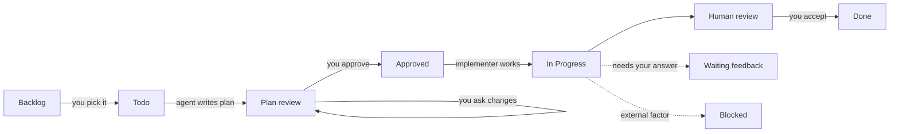

# to-do

A GitHub Project used as a daily work tracker, driven from VS Code by the **Work Buddy** agent and
the `yo-*` commands. Open this repo as a folder (or workspace folder) in VS Code and the agent,
commands, and rules in `.github/` load automatically.

## The idea

- **One project, many repos.** Tasks are issues; the project's **Status** and **Priority** fields
  hold the state. Multiple `repo:*` labels identify the code targets independently of the issue's home.
- **Plan first, then approve.** The agent creates one or more bolt sub-issues, writes a parent
  plan linking them, and stops. You approve that version and its exact bolts before implementation.
- **Goals group tasks.** A goal is a milestone of this repo: the final outcome several tasks work
  toward, with a due date and a "done when" description.
- **You stay in control.** Work Buddy can run only `scripts/yo-gh` in the terminal, never edits code,
  and only you set `Done` or close a goal.

## Status flow

| Status | Meaning |
| --- | --- |
| `Backlog` | Idea, not chosen yet |
| `Todo` | Chosen for now; needs a plan |
| `Plan review` | Plan posted; waiting for you |
| `Approved` | Plan approved; ready to implement |
| `In Progress` | Implementer working |
| `Human review` | Changes ready for your review |
| `Waiting feedback` | Agent needs an answer from you |
| `Blocked` | Stopped by an external factor |
| `Done` | Finished (you set it) |

Priority: `DO NOW`, `Urgent`, `High`, `Medium`, `Low`.

## Code repos and bolts

- Short `repo:<name>` labels resolve under the tracking repo owner by default; for example,
  `repo:service` resolves to `<tracking-repo-owner>/service`. Explicit `repo:other-org/service`
  labels keep their owner. Set `YO_REPO_OWNER` in `yo.env` to override the short-label owner;
  this does not change the Project or tracking repo owner.
- An issue can have multiple repo labels and stay in the tracking repo. `yo-gh show` exposes its
  resolved targets as `repos`; `./scripts/yo-gh resolve-repos repo:service repo:other-org/api`
  resolves labels without contacting GitHub.
- A bolt is a bounded outcome with scope, code targets, acceptance criteria, verification, and
  dependencies. Planning creates at least one linked bolt per main issue, not just one per repo.
  Revisions reuse existing bolts and require new approval for changed scope.
- Workers implement approved bolts in dependency order, using the bolt number in branch names.
  Direct branches share a checkout, so workers targeting the same clone must run sequentially.
  The parent stays open until all bolts and the overall outcome are accepted.
- The approval checklist is enforced through agent instructions, not a server-side or script gate.

## Goals

- A goal is a **milestone in this repo**, titled for the outcome (the team style is
  `[AREA] Outcome`), with a due date and a description that says what "done" means.
- Issues in this repo carry the goal directly. A sub-issue in another repo cannot use this repo's
  milestone, so it belongs to the goal through its parent tracking issue.
- A goal is complete when all its issues are `Done`; you close the milestone.

## Setup

On Windows, prefer opening this repo in VS Code through WSL (Remote - WSL); use Git Bash as a
fallback if WSL is unavailable. Run Work Buddy and `yo-gh` in that same Bash environment. The
workflow needs `python3` for the agent hook, plus `gh`, `jq`, and `git`. Set `YO_REPOS_ROOT` to a
path visible from the chosen environment (for example, `/mnt/c/Users/...` for clones on a Windows
drive in WSL). In Work Buddy's guarded terminal, run `./scripts/yo-gh ...` directly from the
workspace root; do not prefix it with `bash` or wrap it in `wsl.exe`.

1. `gh auth refresh -h github.com -s project` (the login needs the `project` scope; for an org
   with SSO, authorize the token for it).
2. `cp yo.env.example yo.env` and set at least `YO_REPOS_ROOT` (the folder holding your clones).
3. `./scripts/yo-gh setup` ensures the Status options and Priority field. With `YO_PROJECT` set,
  it targets that project and creates it if missing; without it, setup targets every active project
  owned by `YO_OWNER` (or the tracking repo owner when unset). If a project already has items and
  lacks Status options, setup lists the options to add by hand.
4. Open this repo in VS Code and enable the setting `chat.useCustomAgentHooks` (the terminal guard).
5. Pick **Work Buddy** in the agent picker and run `/yo-help`.

When `YO_PROJECT` is omitted, `today`, `next`, and `show` aggregate all active (non-closed) projects
for the configured owner. Results are per project membership, so an issue present in multiple
projects appears multiple times with its project number and title. `status`, `priority`, `setup`, and
`create` apply to every selected project; `create` creates the issue once and adds it to each project.
These multi-project writes are best-effort and report partial failures. To bootstrap a new project
when none are active, set `YO_PROJECT` to a number and run `setup`; it creates a `TODO` project if
that number is not found, then prints the created number.

## Daily flow

1. `/yo-today` → `/yo-triage` → `/yo-plan`.
2. Review the plan: **Revise plan** (or `/yo-revise`) until happy, then **Approve & implement**.
3. The implementer branches `<branchPrefix>/<bolt-number>-<slug>` from an up-to-date default branch in
  each resolved target clone, commits there, and ends in `Human review`. It never pushes unless the plan
   says so.

## Commands

| Command | What it does |
| --- | --- |
| `/yo-help` | List the commands |
| `/yo-today` | Daily summary by goal |
| `/yo-triage` | Brainstorm what to do next; promote items to `Todo` |
| `/yo-capture` | Add an idea to the backlog |
| `/yo-goal` | Review goals or define a new one |
| `/yo-plan` | Plan an issue and post it for approval |
| `/yo-revise` | Revise a plan from feedback |
| `/yo-approve` | Approve the latest plan |

`./scripts/yo-gh` with no arguments prints its usage; `./scripts/yo-gh config` shows the effective
settings and selected projects (`project` is `null` when projects are auto-discovered).

## Files

| File | Purpose |
| --- | --- |
| `.github/agents/work-buddy.agent.md` | The agent, with the approval handoffs |
| `.github/instructions/yo-workflow.instructions.md` | Statuses, goals, repo and branch rules |
| `.github/prompts/yo-*.prompt.md` | The slash commands |
| `scripts/yo-gh` | Wrapper over `gh` for the project |
| `scripts/yo-guard.py` | Hook that limits the agent's terminal to `yo-gh` |
| `yo.env.example` | Per-person settings (copy to `yo.env`) |

Run offline repository-resolution tests with `bash tests/yo-gh-test.sh` (requires Bash and jq).
